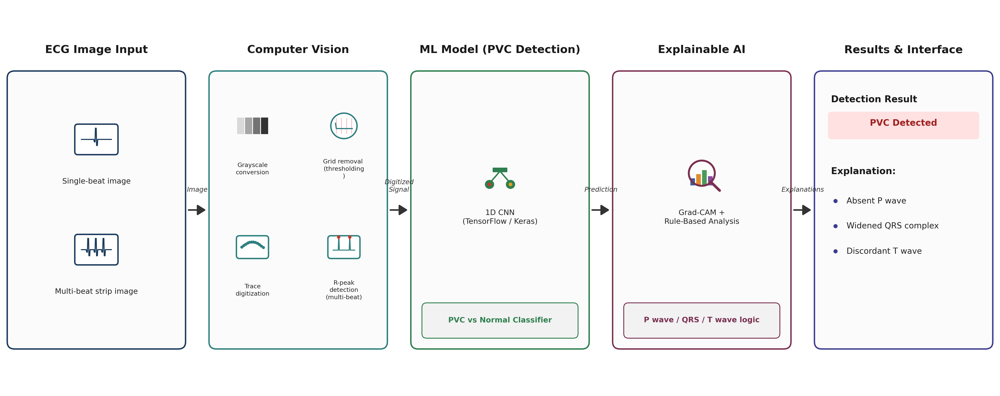

# ECG PVC Detection - Computer Vision + Deep Learning + Explainable AI

Detects **Premature Ventricular Contractions (PVC)** from ECG images using a
computer vision digitization stage, a 1D CNN classifier trained on real
MIT-BIH data, and a dual-layer explainability system (Grad-CAM + rule-based
clinical reasoning). Supports both single isolated beats and continuous
multi-beat rhythm strips, with a Streamlit web interface for live demo use.

**Pipeline:**
`ECG image → CV digitization → 1D CNN classification → Explainable AI → highlighted output + explanation`

---

## Architecture



| Stage | What happens |
|---|---|
| **1. ECG Image Input** | Single-beat image, or a multi-beat strip (e.g. a Lead II rhythm strip) |
| **2. Computer Vision** | Grayscale conversion → grid removal (HSV thresholding) → trace digitization → R-peak detection (multi-beat only) |
| **3. ML Model** | 1D CNN (TensorFlow/Keras), binary classification → PVC / Normal + probability |
| **4. Explainable AI** | Grad-CAM saliency (which part of the signal the CNN attended to) + rule-based clinical checks (P wave, QRS width, T wave polarity) |
| **5. Results & Interface** | Highlighted output image, plain-English clinical explanation, Streamlit UI |

---

## Results (real MIT-BIH data, held-out test set)

Trained on **37,047 beats** from 15 MIT-BIH records (5,767 PVC / 31,280 Normal).

| Class | Precision | Recall | F1-score | Support |
|---|---|---|---|---|
| Normal | 1.00 | 0.99 | 1.00 | 6,257 |
| **PVC** | **0.97** | **0.99** | **0.98** | 1,153 |

**Confusion matrix:**
|  | Predicted Normal | Predicted PVC |
|---|---|---|
| **Actual Normal** | 6225 | 32 |
| **Actual PVC** | 15 | 1138 |

For a medical detection task, **recall on the positive class (PVC) matters
more than raw accuracy** — missing a real PVC (false negative) is worse than
a false alarm (false positive). This model catches 99% of real PVC beats in
the test set.

---

## Project structure
```
MP/
├── src/
│   ├── data_loader.py          # MIT-BIH loading (real + demo/synthetic mode)
│   ├── ecg_image_gen.py        # signal -> ECG image renderer
│   ├── image_to_signal.py      # CV: ECG image -> digitized signal
│   ├── model.py                 # 1D CNN architecture
│   ├── train.py                  # training script, saves model + metrics JSON
│   ├── xai_explain.py           # Grad-CAM + rule-based P/QRS/T reasoning
│   ├── predict_pipeline.py      # single-beat: image in -> explained image out
│   └── multi_beat_pipeline.py   # multi-beat: strip in -> per-beat detection + explanation
├── app.py                       # Streamlit web interface
├── generate_demo_strips.py      # generates varied multi-beat demo strips
├── generate_reasoning_demo_singles.py  # generates single-beat XAI showcase examples
├── run_reasoning_demo.py        # runs showcase beats with known-correct R-peak alignment
├── models/
│   ├── pvc_cnn.keras             # trained model
│   └── train_metrics.json        # real training metrics (for the app's dashboard)
├── data/                          # MIT-BIH raw data + generated images (gitignored)
├── outputs/                       # generated prediction/report images
├── saved_reports/                 # reports saved via the app's "Save to history"
└── requirements.txt
```

---

## Setup

```bash
pip install -r requirements.txt
```

## Get the MIT-BIH data
Download from PhysioNet: https://physionet.org/content/mitdb/1.0.0/
```python
import wfdb
wfdb.dl_database('mitdb', 'data/mitdb', records=[
    '100','101','106','119','200','201','203','208','210',
    '213','215','219','221','223','233'
])
```
(These 15 records were chosen for having a meaningful number of PVC ('V')
annotations — MIT-BIH is heavily imbalanced toward Normal beats.)

## Train
```bash
python src/train.py --mode real --records 100 101 106 119 200 201 203 208 210 213 215 219 221 223 233 --epochs 25
```
Trains with class-weighting (handles the PVC/Normal imbalance), saves the
model to `models/pvc_cnn.keras`, and writes real precision/recall/F1 +
confusion matrix to `models/train_metrics.json`.

## Run — single beat
```bash
python src/predict_pipeline.py --image path/to/beat.png --model models/pvc_cnn.keras
```

## Run — multi-beat strip
```bash
python src/multi_beat_pipeline.py --image path/to/strip.png --model models/pvc_cnn.keras
```

## Run the web interface
```bash
streamlit run app.py
```
Four tabs: **Single Beat**, **Multi-Beat Strip**, **Model Performance**
(real metrics dashboard), **Saved Reports** (browse saved results).

---

## Key design decisions

- **Why image input, not raw signal?** Real-world deployment often only has
  printed, scanned, or photographed ECG strips — not raw digital device
  data. The CV stage makes the system deployable in that setting.
- **Why Lead II?** Standard for continuous rhythm/arrhythmia monitoring
  (ICU telemetry, Holter monitors). MIT-BIH itself is primarily Lead II
  (MLII), so this matches both the training data and real clinical practice.
- **Why 1D CNN, not LSTM/Transformer?** Beats are short, fixed-length, and
  local-pattern-dominated (QRS shape, wave presence). A 1D CNN trains fast,
  needs less data, and Grad-CAM is well-established on CNN features.
- **Why Grad-CAM + rule-based reasoning, not just one?** They act as an
  independent cross-check on each other. When the CNN's confidence is
  genuinely uncertain (e.g. on out-of-distribution input), the rule-based
  layer can still flag concerning features and surface a "recommend
  clinician review" note rather than silently trusting one number.
- **QRS-width threshold (70ms, not the textbook 120ms):** the
  amplitude-threshold-crossing method used here measures a narrower core
  segment than the clinical onset-to-offset convention. Recalibrated
  empirically against real MIT-BIH data (PVC median ≈94ms vs Normal ≈36ms
  under this specific measurement method).
- **Multi-beat R-peak detection** uses prominence (not a fixed height
  threshold), since a wide/tall PVC beat next to normal-sized beats would
  otherwise push normal beats below a height cutoff. A multi-pass merge
  step also corrects for a beat's own T-wave or a wide QRS's secondary
  deflection being mistaken for an extra beat.

---

## Known limitations

- **Train/test split is random (beat-wise), not patient-wise.** A more
  rigorous benchmark would split by patient, since beats from the same
  patient can appear in both sets here.
- **Single-beat vs multi-beat R-peak alignment differs.** Single-beat
  classification uses a signal-derived R-peak estimate; multi-beat
  classification must additionally detect where each beat is within the
  strip, which can shift the effective R-peak position slightly for
  boundary-case beats and change which rule-based criteria fire.
- **Designed for single-lead rhythm strips**, not full 12-lead diagnostic
  ECGs, which serve a different clinical purpose (localized diagnosis vs.
  continuous rhythm monitoring).
- **CV digitization is tuned for clean rendered/scanned strips.** Real
  photographs with calibration pulses, text labels, or heavy skew can
  introduce minor artifacts near the affected region.

---

## Tech stack

Python 3.12 · TensorFlow/Keras · OpenCV · SciPy · NumPy · wfdb ·
scikit-learn · Matplotlib · Pillow · Streamlit
